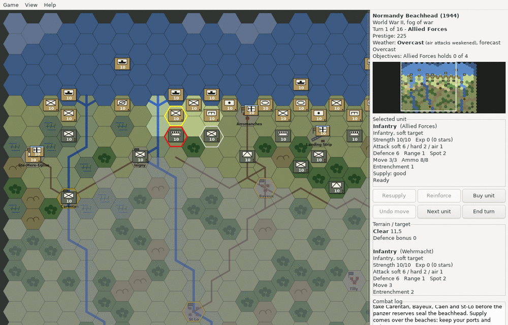
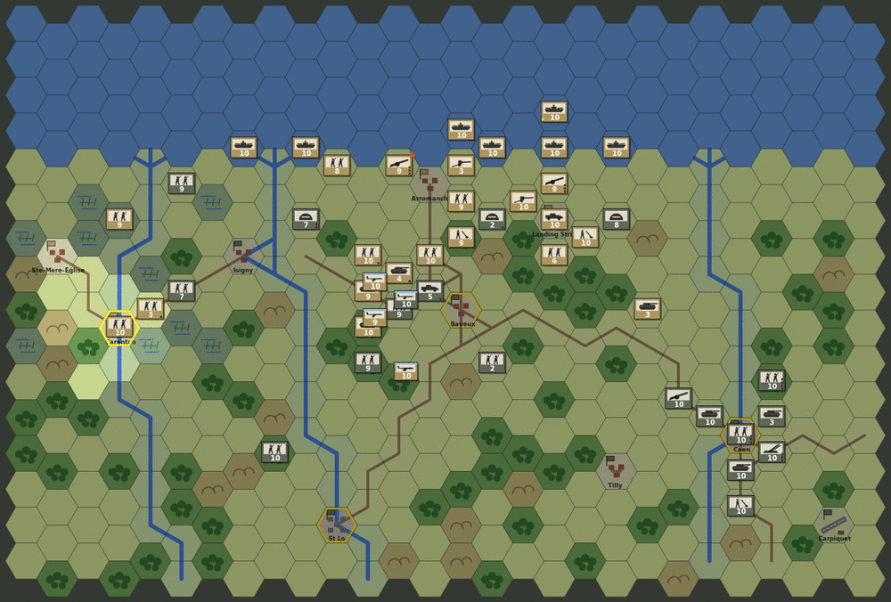
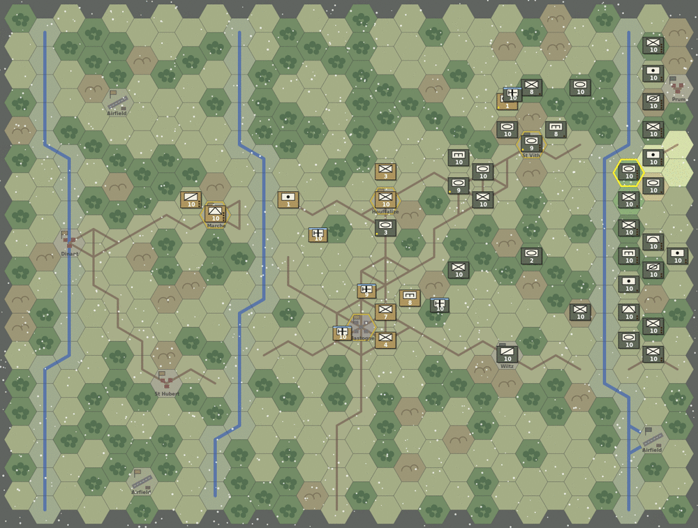
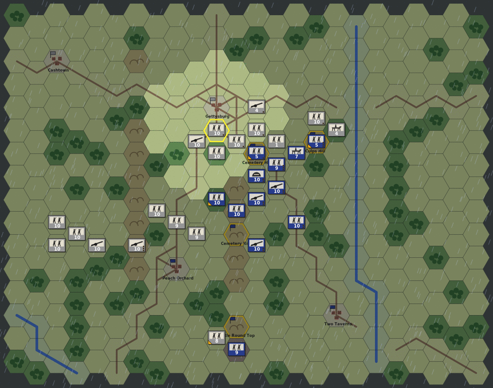
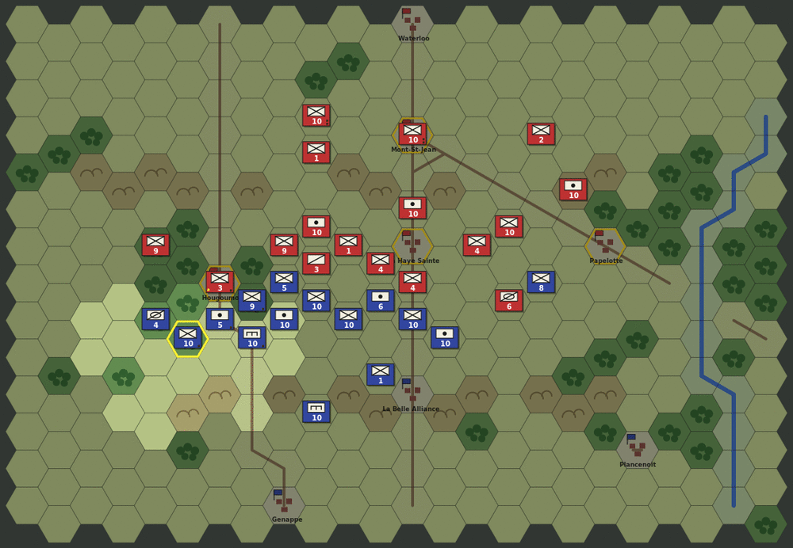
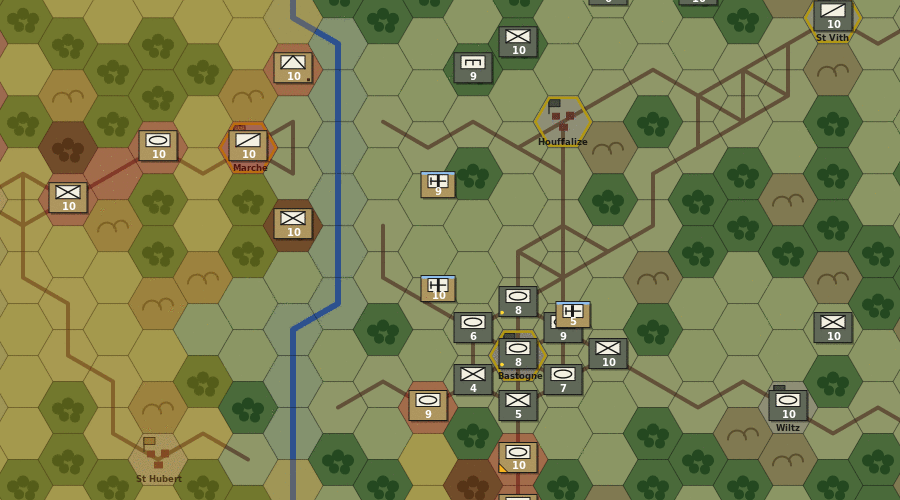
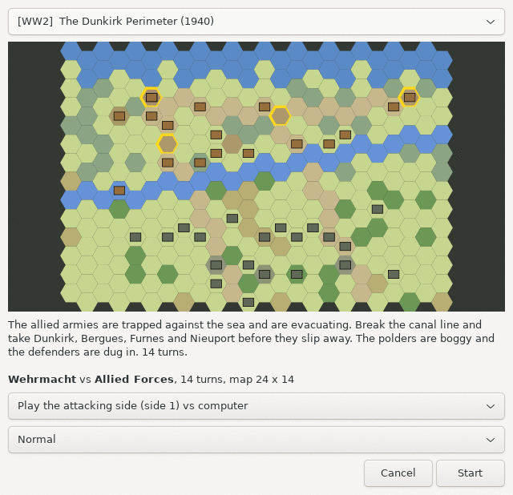

# Hexfront

A turn-based operational hex wargame in the classic style,
written in Ada 2012 with GtkAda (GTK3). One era-neutral engine, with eras and
scenarios defined in plain text data files.

## Features

* Era-neutral engine; WW2, WW1, Napoleonic and American Civil War eras
  defined in data files
* Fog of war with spotting ranges and ambushes
* Air units (fighters, bombers) in a separate air layer, flak and interception;
  aircraft must return to airfields or friendly towns to refuel
* Buying new units with prestige; resupply and reinforcement
* Campaigns: chained battles where surviving core units keep their experience
* Save / load, hot seat (with hand-over screen), watch computer vs computer
* Boot Camp tutorial scenario with pop-up hints that teach wargame basics
* Computer opponent that obeys the fog of war (remembers what it saw);
  can be switched to "sees everything" in the Game menu
* Animated movement and combat (muzzle flashes, explosions, loss numbers)
  with synthesised sound effects (played with paplay / pw-play / aplay)
* Campaigns: Blitz in the West (1940), The Road to Austerlitz (1805),
  Kaiserschlacht (1918), Crusade in Europe (1944)
* Scenarios: Boot Camp tutorial; Meuse, Channel, Dunkirk, Normandy and
  Bastogne (WW2); Big Push, Michael, Marne and Tannenberg (WW1); Ulm,
  Austerlitz and Waterloo (Napoleonic); Gettysburg (Civil War)
* Supply lines: supply flows from own towns, cities, fortresses, airfields
  and the side's map edge, but not through enemy units or their zones of
  control. Low supply means partial resupply; units cut off fight at -1,
  cannot resupply and lose strength each turn after the first.
  View > Show supply lines (S) shades the map
* Weather: fair, overcast, rain, snow and fog, rolled each turn from the
  scenario's climate or scheduled per turn. Rain, snow and fog ground
  aircraft; mud and snow slow movement off the roads; poor visibility
  shortens sight and ranged fire. The status panel shows a forecast
* Warships (battleships, cruisers, destroyers) that sail on water, bombard
  the coast and replenish next to an own port
* Order of battle window (F2) and a clickable minimap
* Optional silhouette unit graphics (View > Unit silhouettes)
* Scenario and campaign chooser with a map preview
* Encirclement: units with no escape hex are surrounded (defence -2, no
  supply). The AI withdraws battered units, concentrates its attacks,
  closes envelopments, picks a "main effort" objective and counter-attacks
  threats to its own objectives
* Campaign HQ between battles: re-equip veteran core units with better
  models of the same class, paid with prestige
* Camera follows the action; zoom with + / - / 0, Ctrl+mouse wheel or the
  View menu ("Fit map to window")
* Scheduled reinforcements (`reinforce turn= side= type= at=c,r [core]`)
* Difficulty levels (Easy / Normal / Hard) for scenarios and campaigns
* Graded results (decisive / normal / narrow); decisive campaign wins give
  bonus prestige and may branch (`stage ... decisive=<id>`)
* Undo the last move (Ctrl+Z) when it revealed nothing new
* Built-in scenario editor (Game > Scenario editor): paint terrain, place
  units, towns and objectives, set up sides, save and play-test

## Screenshots

| | |
|---|---|
|  |  |
| **Normandy, 1944:** warships off the beaches, unit silhouettes | **Bastogne, 1944:** snow slows ground movement, NATO symbols |
|  |  |
| **Gettysburg, 1863:** rain, unit silhouettes | **Waterloo, 1815:** Napoleonic era |
|  |  |
| **Supply overlay:** orange is low supply, red is cut off | **Scenario chooser** with map preview and briefing |

The map images are rendered headlessly with `make screenshots` (needs
ImageMagick); the window shots were taken under Xvfb.

## Build & run

Needs GNAT, gprbuild and GtkAda for GTK3 (Debian/Ubuntu:
`sudo apt install gnat gprbuild libgtkada20-dev`).

    make                                             # or: gprbuild -P hexfront.gpr
    ./bin/hexfront                                   # scenario chooser
    ./bin/hexfront data/scenarios/ww2_meuse.scn      # start directly
    ./bin/hexfront data/scenarios/ww1_bigpush.scn watch   # side1|side2|hotseat|watch

Install (binary to `$PREFIX/bin`, data to `$PREFIX/share/hexfront`, plus a
desktop entry and icon):

    make install PREFIX=$HOME/.local       # default PREFIX is /usr/local
    make uninstall PREFIX=$HOME/.local

The data directory is found via `$HEXFRONT_DATA`, `./data`, `data/` next to
or above the binary, or `<prefix>/share/hexfront`.

Tools:

    make test                    # AI vs AI on every scenario, save/load, editor, campaigns
    make balance ROUNDS=40       # attacker win counts per scenario
    HEXFRONT_ONLY=waterloo ./bin/selftest 30   # only scenarios whose path matches
    ./bin/selftest -s            # supply statistics per scenario
    make render && ./bin/render_png <scn> out.png [sil,supply,turns=N,rain|snow|fog,mini]

A GitHub Actions workflow (`.github/workflows/build.yml`) builds the game,
runs the self-test, renders a couple of maps and test-installs on every push.

## Layout

    src/engine/   era-neutral engine (no GUI dependencies)
      engine-hexes      odd-q hex geometry, distance, neighbours
      engine-terrain    terrain kinds, movement costs, defence bonuses
      engine-units      unit types (from data) and unit instances
      engine-game       game state, movement/ZOC, combat, supply, turns, victory
      engine-loader     .era and .scn parsers
      engine-ai         computer opponent (one unit per step)
      engine-campaign   campaign chains and core-unit carry-over
      engine-save       save/load (~/.hexfront/saves)
      engine-editing    editor operations and the .scn writer
    src/ui/       GtkAda front end (Cairo map renderer, main window, editor,
                  order of battle, campaign HQ, animation and sound)
    data/eras/        ww2.era, ww1.era, napoleonic.era, acw.era
    data/scenarios/   *.scn
    data/campaigns/   *.cmp
    data/sounds/      *.wav sound effects
    tools/            gen_scenarios.py (+ mapgen.py) regenerates the bundled
                      scenarios: python3 tools/gen_scenarios.py
                      gen_sounds.py synthesises data/sounds

## Rules summary

* Move, then attack. Artillery cannot fire after moving. Recon can split moves.
* Entering a hex adjacent to an enemy (zone of control) stops movement.
* Combat: each strength point fires with a hit chance from attack minus defence
  (terrain, entrenchment, experience). The defender returns fire at range 1.
  Nearby `support` guns fire defensively. `bombard` fire suppresses.
* Units that stay still dig in. Resupply or Reinforce (costs prestige) instead
  of moving or attacking.
* The attacker must take every objective (gold ring) before the turn limit.

* Supply and weather as described above.

Era tweaks (`rule` line): `max_entrench`, `charge_bonus` (cavalry shock in the
open), `square_bonus` (infantry vs cavalry), `close_armor_penalty`,
`supply_range` (movement points of full supply; up to twice that is low).

## Data formats

Era file: `unit id=medtank name=Medium_Tank class=armor move=tracked target=hard
mp=6 range=1 soft=7 hard=8 def=8 ammo=8 fuel=50 cost=300 flags=support,bombard`
(underscores become spaces). Movement classes: `foot horse wheeled tracked
static air naval`; class `warship` for ships.

Scenario file: `title`, `description`, `era`, `turns`, `attacker`, `first`,
`side N name= color=r,g,b control=human|ai prestige= income=`, `map W H`
followed by H rows of terrain glyphs, `territory side= cols=A-B`,
`place at=c,r name= owner= [victory]`, `unit side= type= at=c,r [str= exp= entrench=] [core]`.
Optional: `category Tutorial`, `fog on|off`, `buy side=N types=a,b,c|none`,
`hint turn=N text...` or `hint event=select|move|contact|ambush|attack|kill|loss|capture|buy|resupply|reinforce|reinforcements|weather text...`
with `more text...` continuation lines,
`reinforce turn= side= type= at=c,r [core]`,
`climate fair|temperate|wet|winter`, `weather turn=N fair|overcast|rain|snow|fog`
(overrides the climate for that turn),
`supply side=N edge=west|east|north|south|none` (default: the edge behind
the side's starting units).

Campaign file (`data/campaigns/*.cmp`): `title`, `era`, `description`,
`player N`, `prestige N`, and `stage id= file= win=<id|victory> loss=<id|defeat>`.
Units marked `core` are the slots filled by the player's surviving units.

Terrain glyphs: `.` clear `=` road `f` forest `h` hills `M` mountain `~` river
`s` swamp `t` town `C` city `F` fortress `w` water `#` trench `A` airfield.

## License

MIT, see [LICENSE](LICENSE). Copyright (C) 2026 Ulrik Hørlyk Hjort.
Every source file carries the MIT license header.
